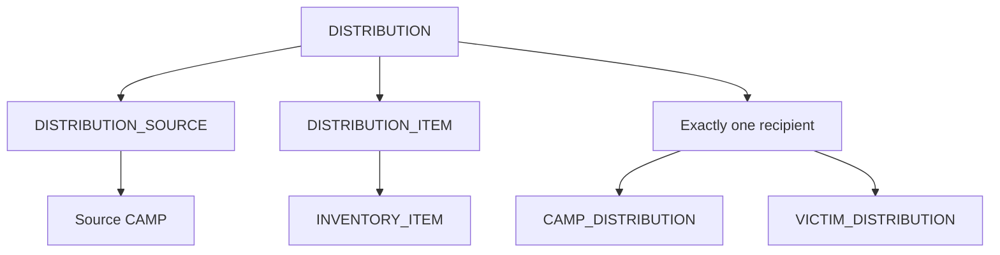

# Implemented schema and submission updates

## Relation mapping

All **23** relations from the submitted written schema are implemented. The earlier review's count of 22 was incorrect.

| Relations | Purpose |
|---|---|
| USER_ACCOUNT | Hashed-password accounts, server-assigned roles |
| DISASTER, CAMP | Disaster events and their camps |
| VICTIM, VICTIM_CAMP_ASSIGNMENT | People and historical camp stays |
| MISSING_REPORT | Reports with optional matched victim |
| VOLUNTEER, VOLUNTEER_ASSIGNMENT, VOLUNTEER_CAMP_ASSIGNMENT | Roster, disaster tasks, optional camp association |
| DONOR, DONATION | Donor master and monetary contributions |
| INVENTORY_ITEM, CAMP_INVENTORY | Item master and per-camp balances |
| DISTRIBUTION, CAMP_DISTRIBUTION, VICTIM_DISTRIBUTION, DISTRIBUTION_ITEM | Transactions, exclusive recipient and item lines |
| MEDICAL_CASE | Conditions, assigned medical account and treatment |
| VEHICLE, VEHICLE_ALLOCATION, VEHICLE_CAMP_ALLOCATION | Fleet, allocation history and optional camp |
| ALERT, CAMP_ALERT | Authored disaster alerts and optional camp |

**One additional relation** is required for actual stock movement: `DISTRIBUTION_SOURCE(distribution_id PK/FK -> DISTRIBUTION, camp_id FK -> CAMP)`. There are therefore **24 physical tables**. It identifies the camp whose stock is debited. It keeps source camp outside DISTRIBUTION, where storing both source_camp_id and disaster_id would introduce the dependency source_camp_id -> disaster_id. Each distribution created through the API has exactly one source.

## Other deliberate additions / scope reconciliation

- DISASTER and CAMP have optional latitude/longitude for map markers. Records without coordinates still appear in listings and reports.
- VEHICLE includes fuel_percentage (0–100), supporting the existing fleet display and low-fuel report.
- DONATION.amount is an integer number of paise, not a formatted string or a binary floating-point value. The API accepts decimal rupees and converts exactly. Display/report amounts use rupees.
- Victim age is represented by DOB rather than a constantly changing stored age. Missing reports retain reported age.
- Inventory operates on camps, matching CAMP_INVENTORY. The old warehouse labels are removed; no warehouse management is claimed.
- Donations are monetary. The old in-kind donation options are removed because the submitted schema has no donation-item relation. This version does not support material donations as donor receipts.
- Undocumented family groups, camp managers and facility lists are removed from operational forms/display. They require additional relations if later needed.
- Alerts are internal saved broadcasts; no external messaging service is connected.
- Current occupancy, low-stock flag, donation totals and dashboard counters are derived. No independently editable duplicate counters exist.

## Constraints

The canonical PostgreSQL schema includes primary keys, foreign keys, non-null alternate keys, CHECK domains/ranges, partial unique indexes for active victim stays and active vehicle allocations, indexes for major joins, and relationship/capacity triggers.

Database triggers reject cross-disaster camp stays, volunteer/camp assignments, vehicle/camp allocations, camp alerts and distribution targets/sources. They also reject a cross-disaster missing-report match, unauthorized medical-user assignment, insertion into a full/closed camp, and closing a camp containing active residents. Camp/victim disaster identity is immutable once created.

The API acquires a PostgreSQL transaction advisory lock before reading and changing balances; row CHECK constraints prevent negative stock. Assignment triggers also lock the affected camp row. Distribution validation checks all lines and the same-disaster recipient before any stock change is committed. A complete transaction inserts the source, exactly one target, and one or more lines; source balances are debited and a target camp balance is credited. All changes roll back together on error.

PostgreSQL deferred constraint triggers check at transaction COMMIT that each distribution has exactly one source, exactly one target and at least one line item. This protects both API and pgAdmin writes. Parent-disaster changes are rejected to keep child relationships consistent. Camp capacity cannot be reduced below occupancy. Re-running the schema is idempotent; it does not drop tables or remove records.

Stock movement is an application service: a raw INSERT into distribution tables does not automatically debit/credit inventory. Use webpage workflows for operational distributions, or explicitly implement the complete movement in your own SQL transaction. Edits to ordinary master fields and balances in pgAdmin are read back directly by the API.
Historical records are retained. Operational buttons release stays, return vehicles, complete tasks, resolve alerts and close cases/camps/events; they do not silently cascade-delete history. Treatment stores the latest treatment summary/date, not a separate clinical encounter log.

## Correct the submitted ER figure

1. Remove USER_ROLE. Use USER_ACCOUNT.role and USER_ACCOUNT 1:N ALERT via created_by.
2. Give VICTIM_CAMP_ASSIGNMENT its own assignment_id, assigned_at, released_at and status.
3. Remove direct camp_id from VOLUNTEER_ASSIGNMENT and VEHICLE_ALLOCATION. Show their optional camp bridge relations and mandatory disaster links.
4. Show CAMP_ALERT, the two exclusive distribution targets, and the new DISTRIBUTION_SOURCE relation.
5. Connect DISTRIBUTION_ITEM to INVENTORY_ITEM and DISTRIBUTION, not directly to CAMP_INVENTORY.
6. Show DONATION -> DONOR and DISASTER, and use MISSING_REPORT consistently.
7. Add coordinate/fuel attributes and note paise storage for monetary amounts.

## Normalization note

The added source bridge has distribution_id as its key; it determines camp_id. Map coordinates and fuel are dependent on their master identifiers. They do not require duplicate derived facts. BCNF remains conditional on the declared complete functional dependencies and business rules; this implementation does not claim a proof for unstated dependencies (for example a driver-name/phone relationship). Nullable VOLUNTEER.user_id is a unique optional association, not an unconditional classical candidate key.

## Simplified distribution topology

Use the full schema.sql for the exact attributes and constraints. The diagram above explains the stock source/line/recipient distinction, not the whole application ERD.
